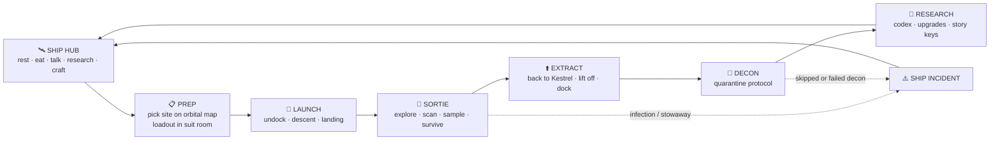

# SEEDFALL: game design plan

*Working title. All names are placeholders and easy to change.*

## 1. The pitch

> **A first-person sci-fi survival-horror game set between two places: a kilometre-long colony
> ship in orbit, which is your home, and the beautiful, silent planet below, which is trying to
> get inside it.**

You are the survey specialist on the colony ark **CSV *Meridian***. A stellar flare cripples the
ship mid-voyage and wakes the crew early. Then a human voice starts singing from an uncharted
world that looks like paradise. You take the **Kestrel** lander down with a **gun and a
scanner** to find out who is singing. Between trips you live aboard the *Meridian*: you
**research what you brought back**, upgrade your gear, eat with the crew, and watch the planet
turn under the solar sails. Every trip down is a risk. Whatever you carry back up could be
carrying something too.

**Genre:** single-player, first-person survival horror and exploration.
**Comparable games (mechanics only):** *Alien: Isolation* (stalker AI), *Subnautica*
(scan, research, upgrade loop), *Prey* (2017, a station you live in), *Returnal*
(a hostile alien biome), *Outer Wilds* (a ship as home base).

---

## 2. Design pillars

Every feature should serve at least one of these.

1. **The ship is home.** It is safe, lived-in and beautiful, and you can sit anywhere. That
   makes it worth protecting, and worse when it stops being safe.
2. **Paradise is wrong.** The planet is gorgeous and totally silent. Dread comes from what is
   missing.
3. **Knowledge is survival.** Scanning and research make you stronger, unlock the story and
   decide the ending.
4. **Protocol under pressure.** Helmets, filters, decontamination and quarantine can all be
   followed or skipped. Cutting corners saves time and costs later.
5. **Every trip down is a gamble.** Go deeper for better samples, or extract now while the
   lander is safe.

---

## 3. Setting

| Element | Description |
|---|---|
| **Era** | Late 22nd century. Humanity sends colony arks to distant worlds. |
| **CSV *Meridian*** | About 1.1 km long. Carries **2,400 colonists in cryo** and a **seed bank** (900 embryos and 40,000 plant seed lines) to the planet **Haven**, 7 years away. |
| **Haven Colonial Trust** | The civilian body that owns the mission. Its cautious protocols are coded into VESTA. |
| **KX-7c, "Verdance"** | The uncharted world: 0.94 g, 31-hour day, two small moons, **breathable air**. That's the trap, because it tempts you to take the helmet off. |
| **The Root** | A planet-wide fungal mind. It consumed all native animal life, including the **Vael**, a civilization that died thousands of years ago. It learned to **mimic radio signals** from a human scout ship that crashed 30 years ago, and uses them to lure ships. A colony ark full of sleeping hosts is exactly what it has been waiting for. |
| **The *Calloway*** | A lost survey ship from 30 years ago. Its wreck is the first site you investigate. Its crew's recorded voices are what the Root replays. |

---

## 4. The player and the crew

**You are the Specialist,** the *Meridian*'s xenobiologist and survey lead. You choose your
name and appearance, which you see in mirrors, cabin photos and your gloved hands.

| Crew member | Role | Purpose in play |
|---|---|---|
| **Capt. Adaeze "Ada" Okonkwo** | Promoted after the flare killed the captain | Gives mission briefings. Pushes for the diversion and has to live with it. |
| **Hollis Brandt** | Pilot | Talks you through landings. Flies the **Mule** rescue in Act II. |
| **Dr. Mirela Varga** | Physician | Runs the med bay, treats infection, performs autopsies on specimens. |
| **Kofi Mensah** | Chief engineer | Handles sails, reactor, the lifter and suit upgrades. |
| **Yuki Tanabe** | Security lead | Runs the armory. Sometimes comes down with you. First to be exposed. |
| **ORIN** | Synthetic steward (android) | A companion on some sorties. Can carry samples and hack doors. Slowly realizes he can *hear* the Root. |
| **VESTA** | Ship AI (voice only) | Ship announcements, quarantine rules, door locks. In Act III, protocol puts her against the crew. |

The crew have **schedules**: meals, shifts and sleep. They talk with each other and with you, and
they have opinions about the diversion. Act II and Act III can take some of them.

---

## 5. The big ship: CSV *Meridian*

### 5.1 Exterior (what you see from windows and on EVA)

```
                 ╭──── COLLECTOR SAILS (golden film, deploy port & starboard, ~3 km span) ────╮
  BOW                                                                                         STERN
  ┌────────────────┐  ┌────────────────────┐  ┌──────────────┐  ┌────────────────────┐  ┌───────────┐
  │ HABITAT MODULE │══│ SPINE + CRYO VAULTS│══│ HANGAR MODULE│══│ TERRAFORMING HOLDS │══│ DRIVE &   │
  │ 3 decks, crew  │  │ 2,400 sleepers,    │  │ Kestrel bay, │  │ A · B · C · D      │  │ REACTOR   │
  │ & science      │  │ seed bank          │  │ Mule cradle  │  │ giant cargo doors  │  │ jump core │
  └────────────────┘  └────────────────────┘  └──────────────┘  └────────────────────┘  └───────────┘
        ▲ observation dome                          ▲ belly doors open to the planet below
```

- **Design language:** clean white and grey composite panels, exposed trusses, bold orange and
  yellow graphics, deck numbers stencilled large. It looks functional, like aerospace equipment,
  not like a warship.
- **In orbit:** the planet fills half the sky out of every window and turns slowly, with
  weather, day and night, and the terminator line all visible. The sails deploy to recharge.
  Both moons pass by.

### 5.2 Walkable interior: deck plan

The playable space is compact. **Cabin to hangar takes under 60 seconds**, with a short spine
tram ride as a breather.

```
HABITAT MODULE ───────────────────────────────────────────────────────────────
 DECK 1 · COMMAND   [ Bridge ]──[ Captain's ready room ]──[ Comms & Nav ]
                         │
                   [ Observation dome ]   ← sit, watch the planet, telescope, photo mode
 DECK 2 · CREW      [ Cabins (yours) ]──[ Galley & mess ]──[ Rec lounge ]──[ Gym & showers ]
                         │                                        │
                    [ Med bay ]──────────────────────────────[ Arboretum ]
 DECK 3 · SCIENCE   [ Research lab ]──[ Specimen quarantine vault ]──[ Workshop & armory ]
                         │
                   (elevator + stairwell connect all decks)
SPINE ────────────────────────────────────────────────────────────────────────
                    [ Spine tram ]══[ Cryo Vault walkway ]══[ Seed Bank ("the Orchard") ]
HANGAR MODULE ────────────────────────────────────────────────────────────────
                    [ Suit room ]──[ Decon airlock ]──[ Kestrel bay ]──[ Mule cradle ]──[ EVA lock ]
AFT ──────────────────────────────────────────────────────────────────────────
                    [ Terraforming Holds A–D ]──[ Engineering ]──[ Reactor & sail control ]
```

### 5.3 Rooms and what you can do in them ("hang out anywhere")

**Every chair, bench, bed and railing can be used:** sit, lie down, lean, look out.
The ship has a **day and night lighting cycle**, with cool white "day shift" and warm amber
"night shift".

| Room | Hang-out activities | Gameplay function |
|---|---|---|
| **Your cabin** | Bed, window, personal terminal (mail, logs), locker (outfits), **trophy shelf** that shows artifacts you've found | **Sleep to save and pass time** (research finishes overnight) |
| **Galley & mess** | Cook or eat meals, coffee machine, crew meals at set times | Meals give a small buff to the next sortie (stamina, calm). Main place for crew conversation |
| **Rec lounge** | Couch and screen with in-universe films, a **music player** (collectible tapes found on the planet), a card game with the crew, an arcade cabinet (later) | Relationships, collectibles |
| **Observation dome** | Sit and watch the planet and sails, **photo mode** | **Telescope:** scan the planet from orbit to **discover new landing sites** |
| **Arboretum** | Tend plants from the seed bank, quiet ambience | Codex entries on Haven flora; calm. Later, an infection outbreak site |
| **Gym & showers** | Workouts, showers | Small stamina progression. The showers become an Act III horror location |
| **Bridge** | Sit in the pilot's chair, look at the planet | **Orbital map** (pick a site, see the comms windows), mission briefings, ship status |
| **Med bay** | Medical scanner | Heal, **treat infection**, **specimen autopsies** (research) |
| **Research lab** | Microscope, sequencer, spectrometer, archive terminal | **Research queue** (section 9.7) |
| **Specimen vault** | Look at live samples behind glass | Rare samples. Escape risk if containment fails |
| **Workshop & armory** | Bench, weapon racks | **Craft** ammo and filters, **upgrade** weapons, suit and scanner |
| **Cryo vaults** | Walk among the 2,400 sleepers, read pod nameplates (name, job, family) | **The stakes.** Colonist health feeds into the ending |
| **Seed Bank ("the Orchard")** | A cold, frosted vault of embryo and seed canisters | Story stakes for Act III |
| **Hangar & suit room** | The Kestrel on its cradle, the suit racks | **Loadout**, launch, decontamination |
| **Terraforming holds** | Giant borers, atmospheric processors, rovers | Act III bomb (the borer) and the airlock-purge climax |
| **Engineering & reactor** | Sail controls | Optional EVA repair missions, power states in Act III |

---

## 6. Getting between the ships

### 6.1 The Kestrel (main lander)

The Kestrel is a 25 m dropship with room for 4 crew, a small med bay, a sample locker and
floodlights.

**Full round trip (all playable, with loading hidden inside the transitions):**

1. **Suit up** in the suit room: helmet, filters, gun, scanner, sample cases.
2. **Board** the Kestrel. Sit in the cockpit or the jump seat.
3. **Undock:** release the cradle clamps, open the belly doors, drop out of the hangar. Manual
   or auto.
4. **Descent:** a short piloted de-orbit burn, then atmospheric entry with buffeting, heat
   glow and comms static. *The planet level loads behind this.*
5. **Approach and landing:** piloted, with assists (auto-hover, landing-zone markers from
   orbital scans). Dust and grass blow out under the thrusters.
6. **On the ground,** the Kestrel is your **mobile safe room**. You can save, stash samples,
   heal with the med kit, and talk to the ship over comms. It is safe until it isn't.
7. **Lift off, ascend** (the ship level loads during ascent), then **dock**: line up with the
   hangar guide lights, manual or auto.
8. **Decontaminate** in the decon airlock before entering the ship (section 9.8).

*After the first trip, "Autopilot" skips any leg so repeat trips stay quick.*

### 6.2 The Mule (heavy cargo lifter)

The Mule is a slow, overpowered cargo sled with a crane arm, normally used to drop
terraforming equipment.

- **Act II:** the Kestrel is destroyed. Hollis flies the Mule down through a storm to pull you
  out. You defend the Mule while it loads, and fight off a Graft on the open deck during
  ascent, using the crane arm.
- **Late game:** used to drop heavy gear, including the Act III borer charge.

### 6.3 EVA (optional, later milestone)

Spacewalks to repair the collector sails, the way the story opens. You move along the hull with
magnetic boots, the planet is below you, and there are only your breathing and the radio.

---

## 7. The planet: Verdance (KX-7c)

**Look and feel:** an overcast sky, a low sun, rolling fog, black volcanic rock, **golden grain-like
grass**, deep green moss, pale fungus, fjords and waterfalls. Breathtaking vistas.

**Sound: no birds, no insects, nothing alive.** Only wind, grass, water and your own breathing.
The silence is the warning, and the first sound of anything moving should make the player's
heart jump.

**Structure:** separate **landing sites**, each a large open zone (roughly 0.5–1 km²) rather than one
seamless planet. Each site is unlocked from the orbital map once it has been scanned from the
observation dome or found through research.

| # | Site | Biome | Content | Threat |
|---|---|---|---|---|
| 1 | **The Signal Fields** | Golden grass plains, lone trees, wind | The **wreck of the *Calloway***. First samples. Tutorial | Low: Censer pods, Chaff |
| 2 | **Mistfall Fjord** | Black cliffs, waterfalls, rain, caves | Cave networks, fungal growth, Vael carvings | Medium: Burrowers, first Grafts |
| 3 | **The Bloomwood** | Dense forest of tall fungus-trees, heavy spore clouds | **Helmet mandatory.** Graft nests. Rare samples | High |
| 4 | **The Quiet City** | Monumental dark basalt ruins of the Vael, petrified bodies | **Glyphs to translate** (research), the truth about the Root | High: Mimics, Grafts |
| 5 | **The Root Vault** | Underground, bioluminescent, organic | The final descent | Extreme |

**Dynamic conditions:**

- **Weather:** clear, fog, rain, or electrical storm. **Storms block comms** with the ship.
- **Day and night:** night is far more dangerous and better for rare samples.
- **Comms windows:** the *Meridian*'s orbit takes it over the horizon, so you get a **comms
  blackout** every few minutes. The HUD shows the countdown. During a blackout there is no
  orbital support.

---

## 8. Core gameplay loop



**Session rhythm:** about 10 minutes on the ship (calm), 20–30 minutes on the planet (tense), then
back to the ship for relief. The ship is the exhale. In Act III, the exhale is taken away.

---

## 9. Systems

### 9.1 Movement and interaction

- Walk, sprint (stamina), crouch, **lean**, jump and mantle. Footstep noise depends on the
  surface and your speed.
- **Context interaction:** look at something to get a prompt, then press to use. Covers doors,
  chairs, beds, terminals, samples, ladders and crates.
- **Flashlight** on the suit, with a battery. **Helmet toggle** (see 9.4).

### 9.2 The scanner (handheld, left hand)

| Mode | What it does | Trade-off |
|---|---|---|
| **Pulse** | A sonar wave that briefly highlights points of interest, samples, hazards and creatures in a radius | **It is audible.** Creatures hear it |
| **Analyze** | Hold on a target to scan it for **codex entries and research data**. Some species need several scans | You stand still and exposed while you scan |
| **Bio-sonar** | A wrist display that shows moving life signs by direction and distance | Wind and spores cause **false contacts**. Upgrades reduce noise |
| **Atmos** | Spore density, filter life, comms signal strength, weather warnings | — |

The scanner also **collects samples**: cut, swab or extract into sample cases. Cases are
limited, so you choose what to bring home.

### 9.3 Weapons (right hand)

This is survival horror: **ammo is scarce, gunfire is loud, and creatures are tough.** Fighting
is a last resort, not a power fantasy.

| Weapon | Role | Notes |
|---|---|---|
| **Sidearm** (start) | Reliable backup | Low damage |
| **Carbine** (start) | Main weapon | Burst fire. Ammo is tight |
| **Breacher shotgun** | Close defence | Unlocked through research |
| **Incendiary projector** | **Burns fungus and Censer pods**, terrifies Grafts | Fuel crafted on the ship |
| **Sonic lure** (throwable) | Creatures hunt by sound, so this pulls them away | Researched from Graft autopsies |
| **Cutter** | Melee and sample tool | Silent |

Ammo, filters and fuel are **crafted in the workshop** from materials salvaged from wrecks and
ship stores.

### 9.4 Health, exposure and infection

- **Health:** injuries and bleeding, treated with med kits.
- **Spore exposure meter:** rises when your **helmet is off** in spore areas, or when your
  filters run out.
- **The helmet trade-off:** helmet ON means no exposure, but **muffled hearing**, a narrower view,
  fogging and limited filter cartridges. Helmet OFF means clear hearing and vision, which helps
  you detect creatures, but you breathe the planet.
- **Infection** (when exposure crosses a threshold) comes in stages:
  1. Coughing (which makes noise and gives away your position) and a tinted view.
  2. Hallucinated sounds (Mimic voices).
  3. Something moving under your skin. **Get to the med bay before stage 3 ends**, or it is
     game over.
- **Cure:** treatment in the *Meridian*'s med bay, or a researched **antifungal injector** for
  use in the field.

### 9.5 Inventory

A grid inventory on the suit, wrist and back. Sample cases have their own slots. The Kestrel has
a **stash locker**. On the ship, items move to your cabin and lab storage.

### 9.6 Crew and dialogue

- Branching but light conversations, plus **briefings** before sorties and **debriefs** after.
- Crew members **react to your choices**: skipping decon, bringing back live specimens, who you
  take down with you.
- Crew can die in the story. Some deaths depend on your choices.

### 9.7 Research (the lab)

Bring samples home and **queue research projects**. Projects take ship time (a few minutes
real time, or finish overnight when you sleep).

| Branch | Fed by | Unlocks |
|---|---|---|
| **Xenobiology** | Flora, spore and tissue samples, autopsies | Codex, antifungal injector, filter efficiency, creature weak points, the sonic lure |
| **Xenoarchaeology** | Vael artifacts, glyph rubbings | Glyph translation, which reveals **the story** and new sites |
| **Signals** | Wreck data, Mimic recordings | Decodes the signal. **Bio-sonar noise filtering**. Locates the Root |
| **Engineering** | Salvage, minerals | Weapon and suit mods, scanner range, sail and lifter repairs |

How much of the research you finish **changes the ending** (section 11).

### 9.8 Quarantine and ship contamination

- After every sortie you go through the **decon airlock**. It takes time, and **you can skip it**
  (VESTA objects, and the crew notice).
- **Sample containment:** live or unstable samples can breach if they are stored badly.
- **Ship Contamination** is a hidden-to-visible meter. A high meter triggers **ship
  incidents**: growth in the vents, a crew member falling sick, a containment breach in the
  lab, the arboretum overrun. Act III's stalker becomes more aggressive at higher levels.

### 9.9 Orbital support (from the *Meridian*)

- **Orbital scan:** reveals the map and landing zones of a new site.
- **Weather forecast** and **comms window** timing.
- **Supply drop** with the Mule (later): ammo, filters.
- **Low orbit** (story choice): bring the ship dangerously low to punch comms through a storm.
  This risks hull stress.

### 9.10 Saving

You can save in your **bunk on the ship** or in the **Kestrel on the planet**. There are also
autosaves at transitions. An optional **"Protocol Mode"** gives you one life and ironman saves.

---

## 10. Bestiary (original creatures)

The visual language is **fungal plus deep-sea**: pale, wet, translucent membranes, bark-like
plating and bioluminescent veins. They are organic and animal-like, not biomechanical.
**Most creatures hunt by sound and vibration**, which ties into the helmet, scanner pulse,
gunfire and sonic lure systems.

| Creature | Type | Behaviour | Counter |
|---|---|---|---|
| **Censer pods** | Hazard | Black-capped fungal bulbs in damp places. **Burst in a spore cloud** when you get close or touch them | Keep your distance, keep the helmet on, burn them |
| **Chaff** | Swarm | Thumb-sized pale crawlers in the grass. They nibble, add exposure, and scatter from light. **They signal that something bigger is near** | Flashlight, fire, keep moving |
| **Burrower** | Ambush | Hunts under the fields. The only sign is a **ripple through the grass** | Bio-sonar, stay on rock |
| **Graft** (core enemy) | Hunter | **Grows inside an infected host** and bursts out. It is a newborn for seconds and full-grown within minutes. Gaunt and fast, with a **petal-like head that opens around a sensory frond**. Hunts by sound | Fire, its weak point (researched), lures, stealth |
| **Mimic** | Lure | Rooted in ruins and forests. **Replays voices and radio chatter** it has absorbed, including your crew's. It produces fake distress calls and fake comms | Signals research can tell fake from real. Kill it to stop the false radio |
| **The Sower** (apex) | Stalker | The Root's **seed carrier**, built to travel. **It stows away aboard.** Small arms can't kill it, so it has to be **lured and purged** | Act III: noise, doors, VESTA, the terraforming-hold airlock |
| **The Root** | Final | The planetary mind under the Quiet City | Act III: the borer charge |

---

## 11. Story outline

### Prologue: "Early Wake"

A stellar flare hits while the sails are deployed. Twelve cryo pods fail, and the captain dies.
VESTA wakes the crew. You **walk the ship** (the tutorial) and help Kofi with sail repairs
(optional EVA). Then the comms console picks up a **woman's voice humming an old folk
lullaby** from KX-7c, a world that shouldn't be there. The crew argue. Ada decides to divert.

### Act I: "First Light"

- First landing in the **Signal Fields**. It is beautiful and silent, and the scanner reads
  *"No fauna detected."*
- You find the ***Calloway* wreck**. Its beacon has been **dead for decades**, so where is the
  voice coming from?
- First Censer pods. **Yuki is exposed.**
- Back on the ship you start your first research. Yuki gets sick. **The first Graft emerges in
  the med bay.** The ship is no longer completely safe.

### Act II: "The Quiet"

- Mistfall Fjord, the Bloomwood and **the Quiet City**. You translate Vael glyphs and learn the
  truth: the Root consumed the Vael and **learned to lure**.
- A Mimic fakes Hollis's voice on comms.
- **The Kestrel is destroyed** and you are stranded in a storm. The *Meridian* drops into
  **dangerously low orbit** to reach you, and **Hollis flies the Mule rescue**. You hold out
  until extraction.

### Act III: "Quarantine"

- **The plan:** drop a terraforming **borer charge** with the Mule into the **Root Vault**, then
  make the final descent.
- **The return:** something came up with you. **The Sower is aboard the *Meridian*.**
  VESTA locks the ship down. Power fails. The crew are hunted. **Protect the cryo vaults.**
- **The climax:** lure the Sower through the ship, using noise, doors and ORIN's help, into
  **Terraforming Hold C**, and **blow the cargo doors**.

### Endings (decided by research, contamination and colonist safety)

| Ending | Condition | Result |
|---|---|---|
| **"Clean Harvest"** | High research, low contamination | The vaults scan clean. The *Meridian* continues to Haven. |
| **"Ash"** | Contamination found in time | You **scuttle part of the cargo**: a sacrifice to save the rest. |
| **"Seedfall"** (the bad and twist ending) | Low research or high contamination | You arrive at Haven… and spores drift from the cryo vents. |

---

## 12. UI and HUD

- **Diegetic first.** The **wrist computer** shows the scanner, inventory, map, codex, logs and
  objectives. The **helmet visor** shows exposure, filter life and comms, and only when the
  helmet is on.
- **No HUD on the ship** except interaction prompts. The ship should feel like a place, not a
  menu.
- **Accessibility:** subtitles with speaker names, a colour-blind-safe scanner palette, FOV and
  head-bob sliders, toggle or hold for sprint, crouch and aim, difficulty options, and an option
  for visual cues for audio-only signals.

## 13. Audio direction (half the horror)

- **Planet:** wind, grass, water, your breathing and suit servos. **No wildlife at all**, so the
  first non-natural sound is a scare.
- **Ship:** a warm hum, distant machinery, the crew chatting, music in the lounge. **Act III
  removes the hum** when the power fails.
- **Creatures:** sparse, wet and close. Mimics use processed human voices.
- **Score:** minimal synth and orchestral drones, kept rare.
- **VESTA:** a calm, measured voice, which gets unsettling when protocol turns cold.

## 14. Art direction

- **Ship:** aerospace realism with clean panels, warm cabin light and cold vaults. Bold
  wayfinding graphics with deck colours: Command blue, Crew amber, Science green, Hangar orange,
  Aft red.
- **Planet:** romantic-sublime landscapes with fog, scale and a low sun, made wrong by the
  silence and the pale fungus creeping into the frame.
- **Ruins:** monumental, dark basalt, organic geometry, petrified Vael figures.
- **Creatures:** see the bestiary. Concept art comes first, before any modelling.

## 15. Controls (keyboard and mouse, plus gamepad)

| Action | KB/M | Gamepad |
|---|---|---|
| Move / look | WASD / mouse | Left / right stick |
| Sprint / crouch | Shift / Ctrl | L3 / B |
| Lean | Q / E | D-pad ← → |
| Interact | F | A |
| Flashlight | L | D-pad ↑ |
| Helmet on/off | H | D-pad ↓ |
| Scanner (raise) / pulse | Tab / LMB while raised | LB / RT while raised |
| Aim / fire / reload | RMB / LMB / R | LT / RT / X |
| Wrist computer | I | View / Select |
| Sit / stand (at seats) | F | A |
