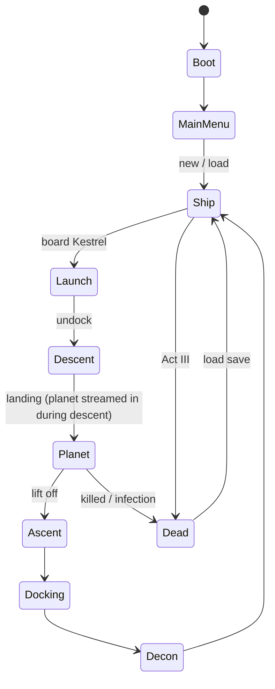

# SEEDFALL: tech plan and roadmap

## 1. Engine decision (the first call to make)

| | **Browser (Three.js + TypeScript)** | **Godot 4** | **Unreal Engine 5** |
|---|---|---|---|
| Visual ceiling | Medium. A stylized-realistic look with heavy fog and lighting | Medium-high | **Highest**: Lumen lighting, Nanite, volumetric fog, MetaHumans |
| Can Claude build **and test** it in the cloud session? | **Yes, fully.** Claude can run it, screenshot it and play-test it with a headless browser | Partly. Code yes, but running it needs the Godot binary, which the network may block | **Code only.** You compile and test on your own PC |
| How you play it | **Open a link** on PC (or phone for viewing) | Exported build (PC or web) | PC build. Needs a strong GPU |
| Cost | Free | Free | Free, with a 5% royalty above $1M gross revenue |
| Best for | Proving the gameplay loop fast and sharing it | A full indie game | The final, best-looking game |

### Recommendation

**Build the vertical slice (milestones M0–M5) as a browser game first.** Claude can build,
run and test every step in the cloud session, and you can play each milestone from a link right
away. Once the loop is fun, **move to Unreal Engine 5** for the full-quality version. The design
docs, data files (items, research, creatures, dialogue) and level layouts carry over directly.
Only the rendering and engine code gets rewritten.

*If you already have UE5 installed on a gaming PC and want to start there now, the plan below
still applies. Claude writes the C++ and Blueprint logic, and you run it.*

---

## 2. Architecture (engine-agnostic)

### 2.1 Game flow (state machine)



### 2.2 Systems and modules

| Layer | Modules | Responsibility |
|---|---|---|
| **Core** | `GameLoop`, `StateMachine`, `EventBus`, `Input`, `SaveSystem`, `Clock` | Frame loop, game states, decoupled events, rebindable input, JSON saves, ship time (shifts) |
| **Player** | `FirstPersonController`, `Interaction`, `Inventory`, `Vitals` | Movement and footstep noise, look-and-interact, grid inventory, health, stamina, exposure, infection |
| **Equipment** | `Scanner`, `Weapons`, `Flashlight`, `Helmet` | Scanner modes, firing and ammo, battery, filters and audio muffling |
| **World: ship** | `Meridian`, `Room` modules, `OrbitView`, `ShipLighting` | Hub level, sit/sleep points, the planet turning outside the windows, day and night shifts |
| **World: planet** | `Terrain`, `Foliage`, `Weather`, `Site` definitions | Heightmap terrain, instanced grass, fog, rain and storms, site points of interest |
| **Vehicles** | `Lander`, `FlightModel`, `Docking` | Cockpit, assisted flight, landing, docking guide |
| **AI** | `Perception`, `Creature`, `Director` | Sight cones and **hearing events with loudness**, per-creature state machines (wander, investigate, hunt, attack, flee), a tension director that paces spawns |
| **Game systems** | `Research`, `Codex`, `Missions`, `Crew`, `Contamination`, `OrbitalSupport` | Data-driven research queue, story flags, NPC schedules and dialogue, ship incidents, comms windows |
| **UI** | `HUD`, `WristComputer`, `Prompts`, `Menus`, `Subtitles` | Diegetic interface |
| **Audio** | `Mixer`, `Ambience`, `Music` | Layered ambience, helmet muffling, positional creature audio |

**One rule:** systems talk through the **EventBus** (`"noise"`, `"sample-collected"`,
`"research-complete"`, `"contamination-changed"`). That way the AI can hear a gunshot without the
gun knowing the AI exists.

### 2.3 Data-driven content

All content lives in data files, so new creatures, samples or research need no code changes.

```
data/
  items.json        weapons, ammo, filters, med kits, sample cases
  samples.json      sample types → research value, contamination risk
  research.json     projects: cost, duration, prerequisites, unlocks
  creatures.json    stats, senses, behaviours, weak points, codex links
  sites.json        landing sites: biome, POIs, threats, weather table
  codex.json        lore entries
  dialogue/*.json   crew conversations, briefings, barks
  missions.json     story flags, objectives, act structure
```

### 2.4 Persistent game state (what a save holds)

```ts
interface GameState {
  act: 0 | 1 | 2 | 3;
  shipTime: number;                     // in shifts
  player: { vitals; inventory; equipment; position: { level: string; x; y; z } };
  ship: { contamination: number; power: 'normal' | 'emergency';
          sails: 'stowed' | 'deployed' | 'damaged';
          colonistsHealthy: number; incidents: string[] };
  lander: { name: 'Kestrel' | 'Mule'; location: 'docked' | string; stash: Item[]; hull: number };
  sites: Record<SiteId, { unlocked: boolean; visited: boolean; poisFound: string[] }>;
  research: { completed: string[]; queue: ResearchJob[]; codex: string[] };
  crew: Record<CrewId, { alive: boolean; affinity: number; flags: string[] }>;
  flags: Record<string, boolean | number>;
}
```

### 2.5 Levels

| Level | Contents | Loading |
|---|---|---|
| `ship_meridian` | Habitat decks, spine, hangar, aft holds | One persistent level, with rooms culled or streamed |
| `transit_*` | Cockpit view, de-orbit, entry and ascent | Short sequences that **hide the loading** |
| `planet_<site>` | One per landing site | Loaded during descent |
| `orbit_backdrop` | Planet sphere with clouds and terminator, moons, sails | Rendered as the window view everywhere on the ship |

---

## 3. Project layout (browser path)

```
seedfall/
  README.md
  docs/                  ← these planning docs
  game/
    package.json  vite.config.ts  index.html
    src/
      main.ts
      core/        loop.ts  state-machine.ts  events.ts  input.ts  save.ts  clock.ts
      player/      controller.ts  interaction.ts  inventory.ts  vitals.ts
      equipment/   scanner.ts  weapons.ts  flashlight.ts  helmet.ts
      world/ship/  meridian.ts  rooms/  orbit-view.ts  lighting.ts
      world/planet/ terrain.ts  foliage.ts  weather.ts  sites/
      vehicles/    lander.ts  flight-model.ts  docking.ts
      ai/          perception.ts  creature.ts  director.ts  creatures/
      systems/     research.ts  codex.ts  missions.ts  crew.ts  contamination.ts  orbital.ts
      ui/          hud.ts  wrist-computer.ts  prompts.ts  menus.ts  subtitles.ts
      audio/       mixer.ts  ambience.ts
    data/          *.json (see 2.3)
    assets/        models/  textures/  audio/
    tests/         Playwright smoke tests (boot, walk, round trip, save/load)
```

**Browser stack:** Vite and TypeScript · three.js · Rapier (physics and the character
controller) · `postprocessing` (bloom, film grain, vignette) · the Web Audio API · glTF models ·
Playwright for automated play-tests.

**UE5 equivalent:** C++ base classes with Blueprint children · Enhanced Input ·
StateTree/Behavior Trees with AI Perception (hearing and sight) · World Partition for planet
sites · Level Streaming for the ship · DataAssets/DataTables in place of the JSON files ·
MetaHumans for the crew.

---

## 4. Roadmap

Each milestone ends in something **playable**, with a clear "done when" test.

**Progress:** ✅ M0 Setup · ✅ M1 "Home" · ⏭️ next: M2 "Between ships" (the Kestrel round trip).
M1 passes a 31-check automated playtest (`game/tests/smoke.mjs`). The walk from your cabin to
the hangar takes about 30 seconds, including the lift ride.

| # | Milestone | Scope | Done when… |
|---|---|---|---|
| **M0** | **Setup** | Engine chosen, project scaffold, input mapping, debug overlay, test harness | A blank scene runs and the first-person camera moves |
| **M1** | **"Home": ship greybox** | Movement, interaction, *Meridian* greybox (cabin, galley, lounge, dome, bridge, lab, med bay, hangar, spine), doors, **sit, lie down and sleep anywhere**, **planet turning outside the windows**, VESTA text lines, save and load | You walk from your cabin to the hangar in under 60 s, sit in any seat, sleep to save, and reload |
| **M2** | **"Between ships"** | The Kestrel: board, cockpit, undock, descent sequence, landing, lift off, ascent, docking. Inventory persists across levels | A full ship → planet → ship round trip with no state lost |
| **M3** | **"Silent Fields"** | Site 1: terrain, grass, fog, wind, weather and comms blackouts, the *Calloway* wreck, **scanner** (pulse, analyze, bio-sonar), samples, **helmet and exposure**, Censer pods | 10+ minutes of exploration with 5 scannable species and 3 collectable samples |
| **M4** | **"Teeth"** | Sidearm and carbine, ammo, damage, **Graft AI** (hearing and sight, hunting), Chaff, player death and reload | Fights are tense and fair, and creatures **react to gunfire and scanner pulses** |
| **M5** | **"Knowledge"** | Research lab and queue, codex, the first upgrades (scanner range, filters, incendiary), decontamination, the **contamination meter**, infection treatment in the med bay | One sortie's samples unlock at least 2 upgrades that matter on the next sortie |
| ⭐ | **VERTICAL SLICE** | **M1–M5 together:** one complete 20–30 minute loop | Playtest, then decide whether to move to UE5 |
| **M6** | **"Crew"** | NPC crew with schedules, dialogue, briefings and debriefs, the mission system, Prologue and Act I | Act I is playable from start to finish |
| **M7** | **"Quarantine"** | **The Sower stalker** with the Director AI, ship power-failure states, Act III systems, the **airlock purge** set piece | The ship hub turns into a horror level that holds up for 30 minutes |
| **M8** | **"The Quiet"** | Sites 2–5, the full bestiary, the Mule rescue, Acts II–III, the three endings | The game can be finished |
| **M9** | **Polish** | Audio pass, art pass, performance, accessibility, settings, save robustness, optional EVA | A release candidate |

### Vertical slice: the exact play-through

1. Wake in your cabin and walk to the bridge (VESTA guides you). The planet is outside the window.
2. Ada briefs you on the orbital map, and you pick **The Signal Fields**.
3. Suit up, take the carbine and scanner, and board the Kestrel.
4. Undock, descend and land in the golden grass. The only sound is wind.
5. Pulse scan, then scan and collect **3 samples**. Find the ***Calloway* wreck** and its dead
   beacon.
6. A Censer pod bursts (helmet decision), the bio-sonar picks up a contact, and you have your
   **first Graft encounter**.
7. Get back to the Kestrel, lift off and dock.
8. **Decontaminate** (or skip it).
9. In the lab, queue research and **sleep** in your bunk.
10. Wake up: research is done. You have **a codex entry and a scanner upgrade**, and the next site
    is unlocked.

---

## 5. Risks and mitigations

| Risk | Mitigation |
|---|---|
| **Scope creep** (a seamless planet, real orbital flight) | Fixed landing sites and transition sequences. Seamless flight is a "maybe later" |
| **Horror AI that feels unfair** | Telegraphing (Chaff before Grafts, the bio-sonar), visible hearing rules, a Director that pulls back after a peak |
| **Art workload for a small team** | Greybox first, a modular ship kit, CC0 asset libraries, concept art before modelling, and fog (cheap, and it fits the theme) |
| **Browser performance** | Instanced grass, LODs, baked light where possible, fog-limited draw distance, a target of 60 fps on a mid-range laptop |
| **Motion sickness in flight segments** | Flight assists, autopilot, comfort settings (FOV, camera shake off) |
| **Getting too close to the film** | The originality table in [01-film-research.md](01-film-research.md#8-what-we-keep-and-what-we-make-original). New names, creatures, story and music |

---

## 6. Asset and tool pipeline

| Need | Source |
|---|---|
| Textures, HDRI skies, rocks | **Poly Haven**, **ambientCG** (CC0) |
| Sci-fi props and greybox kits | **Kenney** (CC0), our own modular kit |
| Character animation | **Mixamo** (free with an Adobe account; check its terms) |
| Sound effects | **Freesound** (check each sound's licence), plus our own recordings |
| Concept art (ship, planet, creatures) | **Higgsfield image generation** (already connected to this workspace; costs credits) |
| Prop meshes | **Higgsfield image → 3D (GLB)** for props, cleaned up after |
| VESTA and crew voices | **ElevenLabs** (connected). Text-only at first, voice later |
| UE5 path | **Fab** marketplace, **MetaHumans**, Quixel assets available through Fab |

Anything that spends credits (concept art, 3D, voices) will be confirmed with you first.

---

## 7. Decisions

Made:

1. **Engine:** browser first (three.js + TypeScript); move to Unreal Engine 5 later if wanted.
2. **Title:** SEEDFALL.
3. **Tone:** slow-burn survival horror.
4. **Look:** realistic. In the browser that means PBR materials, real-time shadows, bloom,
   optional ambient occlusion and a film finish.

Still open:

- Keep the other names (*Meridian / Verdance / VESTA / Kestrel*), or rename them?
- Single-player only (recommended), with co-op as a far-future idea?
