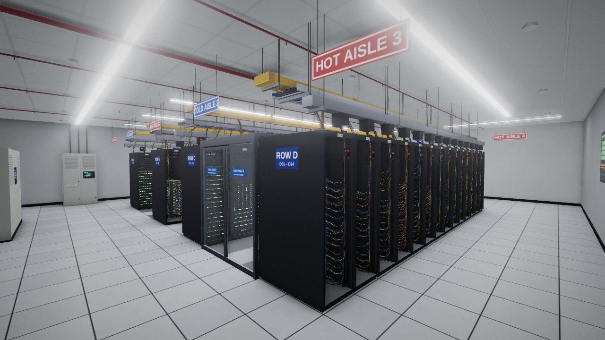
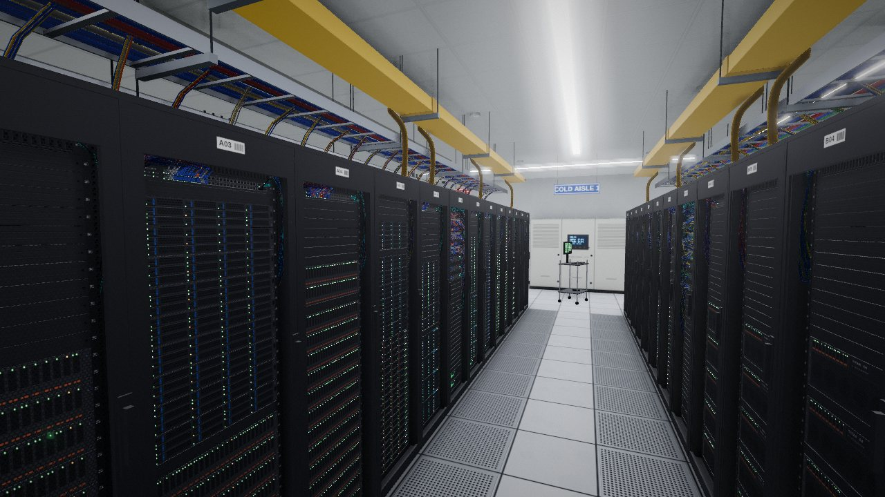
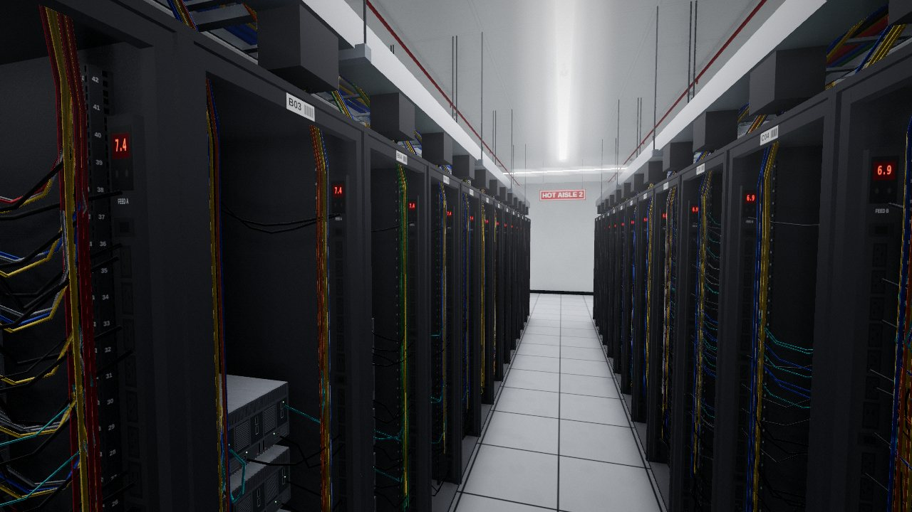
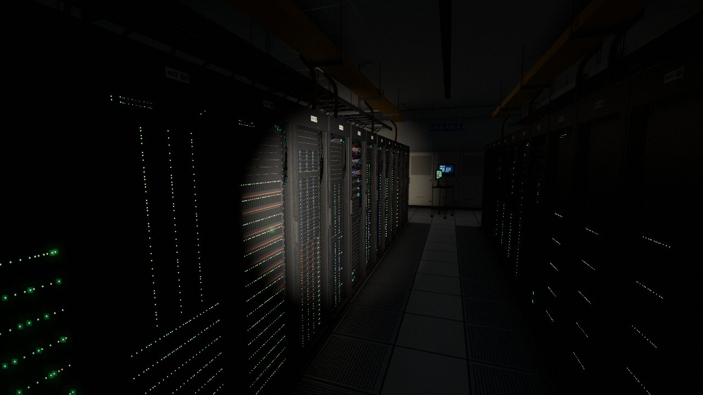

# Data Hall B: a walkable server room

A realistic, first-person data-centre server room that runs in the browser
(Three.js, no build step). Walk the aisles, open rack doors, read the servers,
and close out an incident ticket.



| Cold aisle | Hot aisle |
| --- | --- |
|  |  |



## Run it

**Easiest:** open `dist/data-hall-b.html` in a browser. It is a single
self-contained file (Three.js and all game code inlined), so it works straight
from disk with no server. Rebuild it after editing `src/` with
`npm install && npm run build`.

**From source:** `index.html` loads `src/` as ES modules, so serve the folder
over HTTP rather than opening the file directly:

```bash
cd server-room
python3 -m http.server 8000      # or: npx serve .
# open http://localhost:8000
```

Three.js 0.170.0 loads from jsDelivr through the import map in `index.html`.

| Control | Desktop | Touch |
| --- | --- | --- |
| Walk / look | `W A S D` + mouse (click to capture) | left thumb / right thumb |
| Walk faster | `Shift` | push the stick to the edge |
| Open / close rack door | `E` or click | tap, or **Use** |
| Torch | `F` | **Torch** |
| Room lights (emergency mode) | `L` | **Lights** |
| Crouch | `C` | n/a |
| Sound on/off | `M` | n/a |
| Help | `H` or `?` | `?` |

`?q=low` forces the lighter quality tier (no SSAO, lower resolution, fewer
rear cables). Touch devices pick it automatically, and desktops step down on
their own if they can't hold about 30 fps.

## The ticket

The NOC wall screen shows a major alarm: **INC-48213, PSU redundancy lost on
`db-prod-07`**. Find the server in row B (its health LED blinks amber through
the door mesh), open the rack, check the rear from the hot aisle (PSU 2 has
no cord and its LED is amber), then read the supply-air temperature on
CRAC-02.

## What's in the room

- **Layout on a 600 mm raised-floor grid**: four rows of fourteen 600 × 1200 mm,
  42U racks in a hot/cold aisle arrangement. Rows A/B and C/D face each other
  across 1.8 m cold aisles lined with 25%-open perforated tiles. Cold aisle 2 is
  fully contained (polycarbonate roof, bi-parting doors that open as you approach).
- **1,656 rack-mounted devices**, each painted from a procedural faceplate atlas:
  1U/2U servers with SFF and LFF drive caddies, a 4U storage array, 4U GPU
  servers, 48-port leaf and 32-port spine switches, Cat6A patch panels, cable
  managers, blanking panels, rack UPSs and a KVM drawer. Rears have hot-swap
  PSUs, PCIe NICs, SAS and QSFP ports.
- **About 32,000 animated status LEDs** (power, disk activity, link and activity,
  heartbeat, fault) driven by one instanced shader. Port LEDs only light where a
  cable is plugged in, and a PSU with no cord shows amber.
- **About 10,800 cables** (5,700 on the low tier): patch cords into horizontal managers, A/B-feed power cords
  into inward-facing 0U PDUs, network runs into vertical bundles that rise
  through the rack roof into ladder trays.
- **Overhead services** per row: power busway with tap-off boxes and whips, ladder
  cable tray, yellow fibre runway with spill-outs, unistrut trapezes on
  threaded rod, red VESDA sampling pipe.
- **Cooling and life safety**: three downflow CRAC units with live controller
  displays, an FM-200 clean-agent cylinder bank with release panel, smoke
  detectors, sprinklers, discharge nozzles, CCTV domes, an EPO station,
  an extinguisher and an illuminated exit sign.
- **Props and signage**: power distribution cabinets, a wall panelboard with
  conduit, a crash cart showing the server's IPMI event log, an environmental
  NOC display, hanging hot/cold aisle signs and row end-cap labels.

## How it's built

| File | Role |
| --- | --- |
| `src/painter.js` | Draws each shape into albedo, height, roughness/metal and emissive canvases at once, then derives a normal map. Every texture in the room is generated at load. |
| `src/atlas.js` | The 2048² faceplate atlas (25 front/rear panels). Records LED positions and cable anchors per panel. |
| `src/racks.js` | Rack layout, what's installed in each rack, instanced geometry, LEDs, cabling rules, doors, picking. |
| `src/room.js` | Shell, luminaires and area lights, overhead services, containment, CRACs, fire suppression, entrance, props. |
| `src/lightbake.js` | Bakes floor light visibility and ambient occlusion against the room's occluders at load. |
| `src/materials.js` | Shader patches: per-instance atlas UVs, baked floor mask. |
| `src/leds.js`, `src/cables.js` | Instanced LED billboards; batched tube cables in one mesh. |
| `src/player.js`, `src/hud.js`, `src/tickets.js`, `src/audio.js` | Controls and collision, HUD, the objective, procedural room tone. |
| `src/main.js` | Renderer, environment capture, post chain, game loop. |

Lighting is physically based: continuous LED luminaires backed by matching
`RectAreaLight`s, a baked floor-visibility mask so racks cast light pools and
shadows on the aisles, and a cube-map capture of the lit room (two bounces)
for reflections and fill light. A hemisphere term models bounce off the pale
floor. Post-processing is GTAO ambient occlusion, bloom for LEDs and fixtures,
ACES tone mapping, then a light vignette and grain. The whole scene is about
0.7 M triangles in roughly 170 draw calls.
